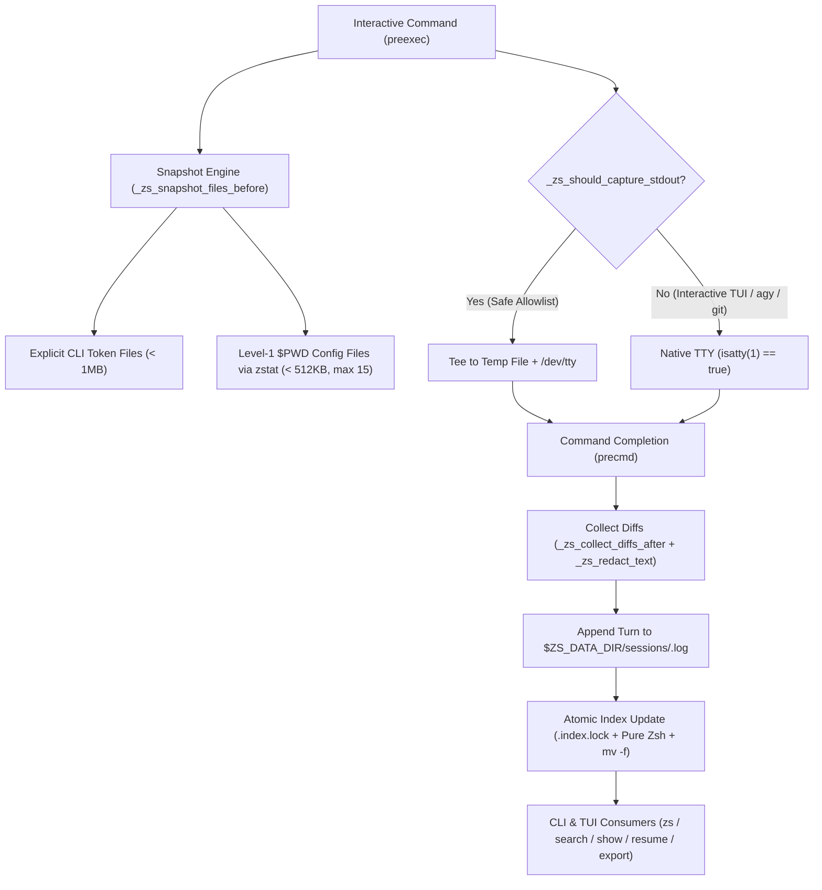

# zsh-sessions v2 Architecture & Productivity Upgrade

*   **Author:** RuyXingubit
*   **Status:** Proposed
*   **Date:** 2026-11-01

--------------------------------------------------------------------------------

## Overview

`zsh-sessions` (`zs`) is an Oh My Zsh plugin that records interactive Zsh sessions as persistent, resumable conversation threads identified by RFC 9562 UUIDv7 keys. Each thread stores executed commands, safe command output, and unified diffs (`diff -u`) of modified configuration files while redacting secrets and discarding trivial navigation sessions on exit.

This design specifies seven structural and functional upgrades for `zsh-sessions` v2:
1. Dynamic English and Brazilian Portuguese (`EN`/`PT-BR`) localization for upstream Oh My Zsh compliance (`PR #14220`).
2. Full-text search across session logs (`zs search <query>` and `Ctrl+S` inside `fzf`).
3. Short UUIDv7 prefix and suffix resolution across all CLI subcommands.
4. Level-1 working directory (`$PWD`) configuration file `mtime` tracking using Zsh's native `zstat` module to capture changes made inside bare editor sessions (`vim`/`nvim` without arguments).
5. Up-arrow (`↑`) command history injection (`print -S`) when resuming a session (`zs resume`).
6. Atomic directory-locked, low-fork `index.tsv` updates to prevent multi-tab race conditions.
7. Markdown runbook export (`zs export [id] [file.md]`).

## The Problem

While `zsh-sessions` v1 captures command turns, file diffs for explicit CLI arguments, and category metadata, seven operational gaps limit its reliability in multi-tab workflows and upstream Oh My Zsh adoption:

1. **Hardcoded Portuguese UI blocks upstream Oh My Zsh acceptance:** All user-facing strings, `fzf` headers, default categories (`"Sem Categoria"`), and `zs -h` output in [zsh-sessions.plugin.zsh](file:///Users/ruy/Documents/antigravity/bold-newton/zsh-sessions.plugin.zsh) are hardcoded in Portuguese, whereas Oh My Zsh requires English by default for non-Portuguese locales.
2. **Title-only search misses historical commands and diffs:** The `fzf` interface only searches `index.tsv` columns (date, category, project, title). Searching for an IP address, port number, or configuration key modified inside a session log fails unless that string happens to appear in the 55-character session title.
3. **Full 36-character UUIDv7 required in CLI commands:** Subcommands (`zs show`, `zs resume`, `zs rm`, `zs cat set`, `zs rename`, `zs ai`) require the full 36-character UUIDv7 string instead of accepting a unique short prefix or suffix.
4. **In-editor file modifications without CLI arguments are missed:** `_zs_snapshot_files_before` only inspects filenames passed as command-line tokens. Running `nvim` or `vim` without arguments and opening `docker-compose.yml` from inside the editor produces no diff.
5. **Resumed sessions do not populate Zsh's up-arrow history:** `zs resume` restores the working directory and prints the last five commands, but pressing the Up Arrow (`↑`) recalls commands from the previous shell buffer rather than the resumed session.
6. **Uncoordinated `index.tsv` rewrites cause multi-tab race conditions and fork overhead:** `_zs_update_index` forks `awk`, `chmod`, and `mv` after every command without file locking. Concurrent terminal tabs executing commands simultaneously can overwrite each other's index updates.
7. **No clean export format for incident runbooks or documentation:** Session logs use internal terminal formatting inside `~/.local/share/zsh-sessions/sessions/<id>.log` and cannot be exported directly to GitHub-flavored Markdown.

## Goals

*   **G1 (Automatic Localization & Backward Compatibility):** Default all CLI outputs, `fzf` menus, and `zs -h` help text to English (`en`), while automatically switching to Brazilian Portuguese (`pt`) when `$ZS_LANG`, `$LC_ALL`, `$LC_MESSAGES`, or `$LANG` starts with `pt` (zero forks). Preserve backward compatibility with existing `"Sem Categoria"` index entries and `"📝 Diff em"` log headers.
*   **G2 (Full-Text Session Search):** Provide `zs search <query>` (and `Ctrl+S` inside `zs` / `fzf`) to search across all `$ZS_DATA_DIR/sessions/*.log` files (commands, outputs, and file diffs) using standard POSIX tools (`grep`/`awk`) with zero mandatory external dependencies beyond optional `fzf`.
*   **G3 (Short UUIDv7 Resolution with Ambiguity & Path-Traversal Guards):** Resolve short UUIDv7 prefixes, suffixes, or unique substrings in 0 forks across all session-targeted subcommands (`show`, `resume`, `rm`, `cat set`, `rename`, `ai`, `export`), rejecting path traversal characters (`/` or `..`) and aborting with a candidate list when a short prefix matches multiple sessions.
*   **G4 (Zero-Fork Level-1 Config Diff Tracking):** Track level-1 configuration files (`*.yml`, `*.yaml`, `*.json`, `*.conf`, `*.toml`, `*.ini`, `*.xml`, `*.properties`) in `$PWD` under 512 KB (up to 15 files, excluding lockfiles) using Zsh's built-in `zstat` module so modifications and newly created config files inside bare `vim`/`nvim` or scripts are diffed automatically while honoring `_zs_is_sensitive_file`.
*   **G5 (Up-Arrow History Recall on Resume):** Push up to the last 50 commands of a resumed session into the active shell's history list via `builtin print -S` during `zs resume`.
*   **G6 (Atomic Low-Fork Index Synchronization):** Serialize all `index.tsv` modifications across concurrent terminal tabs using a POSIX atomic lock directory (`$ZS_DATA_DIR/.index.lock`) with `zstat`-based stale-lock recovery (> 2 seconds) and pure-Zsh row updates under `umask 0077`.
*   **G7 (Markdown Runbook Export):** Add `zs export [id] [file.md]` (and an export option in the `Tab` action menu) to render any session into a redacted GitHub-flavored Markdown document with metadata, `zsh` command blocks, `text` output blocks, and `diff` blocks.

## Non-Goals

*   **NG1 (Recursive Filesystem Watchers):** Monitoring subdirectories recursively or spawning background `fswatch`/`inotifywait` daemons is out of scope to preserve instant shell prompt return times.
*   **NG2 (External Database Engines):** Replacing flat TSV/log files with `sqlite3` or external binary databases is out of scope to maintain 100% compliance with Oh My Zsh's zero-dependency plugin architecture.
*   **NG3 (Global `stdout` Pipe Interception for Interactive TUIs):** Intercepting `fd 1` (`isatty(1)`) for interactive applications (`agy`, `git`, `python`, `node`, `vim`) remains strictly out of scope; `ZS_CAPTURE_MODE="safe"` allowlist behavior is preserved.

## Open Questions

None. All architectural questions were resolved during the `/egm-brainstorm` phase.

## Critical User Journeys (CUJs)

### CUJ 1: Automatic Locale Switching for Upstream Oh My Zsh and Local PT-BR Use

*   **Given**: A user on a Portuguese macOS system (`LANG=pt_BR.UTF-8`) and an upstream Oh My Zsh reviewer on an English system (`LANG=en_US.UTF-8`), with existing sessions stored in `index.tsv`.
*   **When**: Both users run `zs -h`, `zs status`, `zs cat list`, or `zs`.
*   **Then**: The `pt_BR` user sees all prompts, help examples, and headers in Portuguese, while the `en_US` user sees all prompts, help examples, and headers in English. Both environments recognize historical `"Sem Categoria"` and `"Uncategorized"` entries without losing session state.

### CUJ 2: Searching Historical Logs by IP, Port, or Diff Content

*   **Given**: A user modified `port: 6380` inside a `docker-compose.yml` file several days ago in a session whose title does not mention `6380`.
*   **When**: The user runs `zs search 6380` (or presses `Ctrl+S` inside `zs` and types `6380`).
*   **Then**: `zs` searches across `$ZS_DATA_DIR/sessions/*.log`, displays the matching session metadata and highlighted `+    port: 6380` diff line, and allows resuming or inspecting that session immediately.

### CUJ 3: Editing a Config File Inside Bare `nvim`/`vim` and Exporting a Runbook

*   **Given**: A user is in a project directory containing `app.yml` and runs `nvim` (with no filename argument), edits `app.yml` inside the editor, saves, and exits.
*   **When**: The user runs `zs show <short-id-suffix>` and then `zs export <short-id-suffix> runbook.md`.
*   **Then**: `zs show` resolves the short UUIDv7 suffix and displays the unified diff of `app.yml` (with any secrets masked as `[REDACTED]`), and `zs export` writes a formatted Markdown runbook to `runbook.md`.

## Technical Plan (Architecture)

The v2 architecture extends [zsh-sessions.plugin.zsh](file:///Users/ruy/Documents/antigravity/bold-newton/zsh-sessions.plugin.zsh) and [_zs](file:///Users/ruy/Documents/antigravity/bold-newton/_zs) through seven internal subsystems while keeping zero external runtime dependencies beyond standard POSIX utilities (`awk`, `grep`, `sed`, `diff`, `mkdir`, `mv`) and optional `fzf`.



### 1. Dynamic Zero-Fork Localization Engine (`_zs_is_pt`, `_zs_tr`, `_zs_is_uncategorized_val`)

*   **Locale Detection (`_zs_is_pt`)**: Inspects `${ZS_LANG:-${LC_ALL:-${LC_MESSAGES:-${LANG:-en}}}}` using pure Zsh pattern matching (`[[ "${loc:l}" == pt* ]]`). Returns `0` for Portuguese (`pt`, `pt_BR`, `pt_PT`) and `1` for English (default fallback for `en_*`, `C`, `POSIX`, or unset).
*   **String Helper (`_zs_tr "en_str" "pt_str"`)**: Outputs `"$2"` when `_zs_is_pt` succeeds and `"$1"` otherwise, with zero subshells when assigned or printed directly.
*   **Backward-Compatible Category & Log Predicates**:
    *   `_zs_default_category()` returns `"Sem Categoria"` in `pt` and `"Uncategorized"` in `en`.
    *   `_zs_is_uncategorized_val "$cat"` returns `0` if `$cat` is empty, `"Sem Categoria"`, or `"Uncategorized"`. All checks in `_zs_cat_list`, `_zs_handle_shell_exit_prompt`, and `_zs_notify_pending_categories` call `_zs_is_uncategorized_val` so switching locales never orphans historical sessions.
    *   Log syntax highlighters in `_zs_show_session` and summarizers in `_zs_ai_categorize` match both `^  📝 Diff (em|in) ` and `^  🔒`.

### 2. Centralized Short UUIDv7 Resolver (`_zs_resolve_sid`)

*   **Signature**: `_zs_resolve_sid <query> [allow_default_current=1]`
*   **Resolution Order**:
    1.  If `<query>` is empty and `allow_default_current == 1`, outputs `$ZS_SESSION_ID` and returns `0`.
    2.  **Security Guard**: Rejects any `<query>` containing `/` or `..` (`[[ "$query" == (*/*|*..*) ]] && return 1`) to prevent path traversal outside `$ZS_DATA_DIR/sessions/`.
    3.  **Exact Match (0 forks)**: If `<query>` equals `$ZS_SESSION_ID` or `$ZS_DATA_DIR/sessions/${query}.log` exists, outputs `<query>` and returns `0`.
    4.  **Candidate Enumeration (0 forks)**: Gathers unique session IDs from `$ZS_DATA_DIR/sessions/*.log(N:t:r)`, `$ZS_DATA_DIR/index.tsv` column 1, and `$ZS_SESSION_ID`.
    5.  **Prefix / Suffix / Substring Matching**:
        *   First pass checks case-insensitive prefix (`${cand}` starts with `${q}`) or suffix (`${cand}` ends with `${q}`).
        *   Second pass (if first pass yields 0 matches) checks substring containment (`${cand}` contains `${q}`).
    6.  **Ambiguity Handling**:
        *   `1` match: outputs the resolved 36-character UUIDv7 and returns `0`.
        *   `> 1` matches: prints an error to `stderr` listing the matching UUIDv7 candidates and returns `1` (preventing destructive collisions in `zs rm`).
        *   `0` matches: returns `1`.

### 3. Level-1 Directory Config Snapshot & Diff Engine (`zstat`)

*   **Zero-Fork Metadata Helper (`_zs_file_mtime_size`)**: Uses `zstat -H st "$filepath"` from `zsh/stat` to retrieve modification time (`$st[mtime]`) and byte size (`$st[size]`) without spawning `stat` or `wc`.
*   **Pre-Command Snapshot (`_zs_snapshot_files_before`)**:
    1.  Scans explicit CLI tokens first (up to 5 files `< 1 MB`).
    2.  Globs level-1 configuration files in the current working directory: `$PWD/*.(yml|yaml|json|conf|toml|ini|xml|properties)(N.)`.
    3.  Excludes noisy lock/build files (`package-lock.json`, `composer.lock`, `pnpm-lock.yaml`, `yarn.lock`, `Cargo.lock`, `tsconfig.tsbuildinfo`) and files `>= 524288` bytes (512 KB), up to a maximum of `ZS_MAX_DIR_SNAP_FILES=15` files.
    4.  Routes any file matching `_zs_is_sensitive_file` strictly to `_ZS_SENSITIVE_TOUCHED` (`mtime` tracking only; file contents are never copied).
    5.  Copies non-sensitive config files into `$_ZS_SNAP_DIR` and records all existing level-1 config filenames in `_ZS_PWD_EXISTING_CONFIGS`.
*   **Post-Command Diff Collection (`_zs_collect_diffs_after`)**:
    1.  Compares snapshotted files via `cmp -s` and generates redacted `diff -u` blocks for modified files.
    2.  Re-globs `$PWD/*.(yml|yaml|json|conf|toml|ini|xml|properties)(N.)` to detect **newly created** config files saved during a bare `vim`/`nvim` session or script execution. Any new file not in `_ZS_PWD_EXISTING_CONFIGS` is checked against `_zs_is_sensitive_file` (recording `🔒` if sensitive, or diffing against an empty file if non-sensitive and `< 512 KB`).

### 4. Atomic Directory-Locked, Pure-Zsh `index.tsv` Manager

*   **Lock Acquisition (`_zs_acquire_index_lock` / `_zs_release_index_lock`)**:
    *   Attempts `command mkdir "$ZS_DATA_DIR/.index.lock" 2>/dev/null`.
    *   If lock acquisition fails, inspects `.index.lock` `mtime` via `zstat`; if older than 2 seconds (`EPOCHSECONDS - st[mtime] > 2`), removes the stale lock directory and retries (up to 20 iterations with `0.01s` backoff).
*   **Pure-Zsh Index Operations**:
    *   `_zs_update_index`, `_zs_remove_session_files`, `_zs_cat_set`, and `_zs_rename_session` acquire `.index.lock`, read existing rows from `$ZS_DATA_DIR/index.tsv` using a pure-Zsh `while IFS=$'\t' read -r ...` loop (0 forks), write updated rows to `$ZS_DATA_DIR/index.tsv.tmp.$$` inside a `( umask 0077; ... )` subshell or local umask block, atomically replace `$ZS_DATA_DIR/index.tsv` via `command mv -f`, and release `.index.lock`.

### 5. Full-Text Session Search (`_zs_search_sessions` & `Ctrl+S` in `fzf`)

*   **CLI Search (`zs search <query>`)**:
    *   Searches `$ZS_DATA_DIR/sessions/*.log` case-insensitively using `command grep -niF -- "$query"`.
    *   Groups matching lines by session ID, looks up session metadata (`Date`, `Category`, `Project`, `Title`) from `index.tsv`, and prints formatted match blocks with ANSI color highlights.
    *   Returns `0` when matches are found and `1` when no matches exist.
*   **Interactive `fzf` Search (`zs search` with no args, or pressing `Ctrl+S` inside `zs`)**:
    *   Streams all turns and diff lines from `$ZS_DATA_DIR/sessions/*.log` prefixed with `<sid>\t[<category> | <project>] <log_line>` into `fzf --ansi --delimiter='\t' --with-nth=2.. --preview="$preview_cmd"`.
    *   Selecting a matching line opens the session action menu (`_zs_action_menu_for_session`) for that session ID.

### 6. Up-Arrow History Injection on Resume (`_zs_resume_session`)

*   When `zs resume <id>` resolves a session via `_zs_resolve_sid`, it parses turn headers (`^\[[0-9]{2}:[0-9]{2}:[0-9]{2}\] .* \$ .* \(exit: -?[0-9]+ \| [0-9]+s\)$`) from `$ZS_DATA_DIR/sessions/$ZS_SESSION_ID.log`.
*   Extracts the command string between ` $ ` and ` (exit: `, deduplicates consecutive identical commands, takes the last 50 commands, and injects each into Zsh's interactive history stack via `builtin print -S -- "$cmd"`.

### 7. Markdown Runbook Exporter (`_zs_export_session`)

*   **Invocation**: `zs export [id_or_file] [file.md]` (also added as an option in `_zs_action_menu_for_session`).
*   **Argument Resolution**:
    *   If `$1` is omitted: exports `$ZS_SESSION_ID` to `./session-${ZS_SESSION_ID[1,8]}.md`.
    *   If `$1` resolves via `_zs_resolve_sid "$1" 0`: uses that session ID and writes to `${2:-./session-${sid[1,8]}.md}`.
    *   Otherwise (e.g., `zs export runbook.md`): exports `$ZS_SESSION_ID` directly to `$1`.
*   **Markdown Rendering**:
    *   Parses `$ZS_DATA_DIR/sessions/$sid.log` in a single pass, outputting a `# <Title>` header, a Markdown metadata table (`ID`, `Date`, `Category`, `Project`, `Directory`), numbered step headings (`### Step N (\`HH:MM:SS\` | exit: \`0\` | \`0s\`)`), fenced ```` ```zsh ```` command blocks, fenced ```` ```text ```` output blocks, and fenced ```` ```diff ```` blocks (stripping the 4-space log indentation), piped through `_zs_redact_text`.

## Alternatives Considered

### Alternative A: External `flock` Binary for `index.tsv` Concurrency Locking

*   **Pros**: Single-line shell wrapper around file descriptors (`flock -x 200`).
*   **Cons**: macOS does not ship `flock` in the base `/usr/bin` or `/bin` system paths (requiring Homebrew `util-linux`).
*   **Reason for Rejection**: Rejected because `zsh-sessions` must operate out-of-the-box on both stock macOS and Linux without external binary dependencies. Atomic directory creation (`mkdir "$ZS_DATA_DIR/.index.lock"`) combined with `zstat` stale-lock recovery is 100% POSIX-portable and zero-dependency.

### Alternative B: Mandatory `ripgrep` (`rg`) for `zs search`

*   **Pros**: Fast parallel search with built-in file globbing and color formatting.
*   **Cons**: Requires users and remote SSH servers to install `ripgrep` before `zs search` or `Ctrl+S` works.
*   **Reason for Rejection**: Rejected to preserve zero mandatory dependencies. Because session logs are bounded per command (`ZS_MAX_OUTPUT_LINES=60`) and stored in a single flat directory (`$ZS_DATA_DIR/sessions/*.log`), standard `grep -niF` and `awk` search hundreds of sessions in single-digit milliseconds everywhere.

### Alternative C: Recursive Directory Snapshotting (`$PWD/**/*`) for In-Editor Diffs

*   **Pros**: Would detect configuration files modified inside nested subdirectories when running bare `vim`/`nvim` from a repository root.
*   **Cons**: Recursive globbing (`**/*`) in large repositories (containing `node_modules`, `.git`, `build`, or `.venv`) causes hundreds of milliseconds or seconds of delay before every prompt command.
*   **Reason for Rejection**: Rejected due to prompt latency risk. Combining explicit CLI path token snapshotting (which supports arbitrary relative/absolute paths like `vim config/prod/app.yml`) with level-1 `$PWD` config globbing (`max 15` files `< 512 KB`) captures bare-editor changes in the current directory in under 2ms.

--------------------------------------------------------------------------------

## Non-Functional Requirements

*   **Security & Privacy**:
    *   All session storage directories (`$ZS_DATA_DIR`, `$ZS_DATA_DIR/sessions`, temporary snapshot directories) enforce `0700` permissions, and all log, index, and temporary files enforce `0600` permissions via `umask 0077`.
    *   `_zs_resolve_sid` strictly rejects any session ID query containing `/` or `..` to prevent path traversal attacks.
    *   `_zs_is_sensitive_file` blocks content copying and diff generation for `.env*`, `*.pem`, `*.key`, `id_rsa*`, `id_ed25519*`, `*credentials*`, `*secret*`, `.netrc`, `.npmrc`, `.pypirc`, and `.pgpass` across both CLI token snapshots and level-1 `$PWD` snapshots.
    *   `_zs_redact_text` masks secrets, tokens, passwords, and connection URLs with `[REDACTED]` across command logs, diffs, and exported Markdown runbooks.
*   **Performance & Latency**:
    *   Shell startup initialization remains zero-fork (`< 10ms`) by using `zsh/datetime` (`strftime`), `zsh/stat` (`zstat`), `$RANDOM` UUIDv7 generation, and pure-Zsh `.git/HEAD` inspection.
    *   `index.tsv` updates avoid spawning `awk` and `chmod` on every command turn by reading and writing rows in pure Zsh under `umask 0077`.
*   **Rollout & Backward Compatibility**:
    *   Existing `index.tsv` files with `"Sem Categoria"` and session logs with `"📝 Diff em"` remain 100% compatible across both `en` and `pt` locales without requiring data migration.

--------------------------------------------------------------------------------

## Detailed Implementation Plan

### Target Files to Create/Modify

#### 1. [`./zsh-sessions.plugin.zsh`](file:///Users/ruy/Documents/antigravity/bold-newton/zsh-sessions.plugin.zsh) (Modify)

*   **Type / Scope**: Core Zsh Plugin Implementation
*   **Rationale**: Implements all seven v2 functional and architectural upgrades inside the single plugin entrypoint required by Oh My Zsh.
*   **Proposed Changes**:
    *   **Configuration Variables**: Add `typeset -g ZS_LANG="${ZS_LANG:-}"` and `typeset -gi ZS_MAX_DIR_SNAP_FILES="${ZS_MAX_DIR_SNAP_FILES:-15}"`.
    *   **Localization Functions**:
        *   `_zs_is_pt()`: Evaluates `${ZS_LANG:-${LC_ALL:-${LC_MESSAGES:-${LANG:-en}}}}` against `(#i)pt*` in 0 forks.
        *   `_zs_tr <en_text> <pt_text>`: Prints localized text based on `_zs_is_pt`.
        *   `_zs_default_category()`: Returns `"Sem Categoria"` (`pt`) or `"Uncategorized"` (`en`).
        *   `_zs_is_uncategorized_val <value>`: Returns `0` when `<value>` is empty, `"Sem Categoria"`, or `"Uncategorized"`.
        *   Localize all user-facing messages across `_zs_cat_add`, `_zs_cat_list`, `_zs_cat_set`, `_zs_interactive_choose_category`, `_zs_notify_pending_categories`, `_zs_show_session`, `_zs_rename_session`, `_zs_resume_session`, `_zs_ai_categorize`, `_zs_action_menu_for_session`, `_zs_open_tui`, `_zs_print_help`, and `zs()`.
    *   **Atomic Index Locking & Pure-Zsh Index Updates**:
        *   `_zs_acquire_index_lock()` / `_zs_release_index_lock()`: Atomic `mkdir "$ZS_DATA_DIR/.index.lock"` with `zstat` stale-lock recovery (`> 2s`).
        *   Refactor `_zs_update_index`, `_zs_remove_session_files`, `_zs_cat_set`, and `_zs_rename_session` to use pure-Zsh `while IFS=$'\t' read -r ...` loops under `umask 0077` + `mv -f` inside the lock.
    *   **Short UUIDv7 Resolver**:
        *   `_zs_resolve_sid <query> [allow_default_current]`: Rejects `/` and `..`, checks exact match, then resolves unique prefix, suffix, or substring across `$ZS_DATA_DIR/sessions/*.log` and `index.tsv`, emitting a localized ambiguity error to `stderr` if `> 1` sessions match.
        *   Integrate `_zs_resolve_sid` into `_zs_show_session`, `_zs_resume_session`, `_zs_rename_session`, `_zs_cat_set`, `_zs_ai_categorize`, `_zs_export_session`, and `zs rm`.
    *   **Level-1 Directory Config Snapshot & Diff (`zstat`)**:
        *   `_zs_file_mtime_size <filepath>`: Populates `_ZS_STAT_MTIME` and `_ZS_STAT_SIZE` via `zstat -H` in 0 forks.
        *   Extend `_zs_snapshot_files_before` to glob `$PWD/*.(yml|yaml|json|conf|toml|ini|xml|properties)(N.)` (`< 512 KB`, max `ZS_MAX_DIR_SNAP_FILES`, excluding lockfiles) and record initial paths in `_ZS_PWD_EXISTING_CONFIGS`.
        *   Extend `_zs_collect_diffs_after` to detect newly created level-1 config files saved during the command turn (checking `_zs_is_sensitive_file` first).
    *   **Up-Arrow History Injection on Resume**:
        *   Update `_zs_resume_session` to parse command headers from `$ZS_DATA_DIR/sessions/$ZS_SESSION_ID.log` and push up to the last 50 commands into Zsh's history list via `builtin print -S -- "$cmd"`.
    *   **Full-Text Session Search**:
        *   `_zs_search_sessions [query]`: Searches `$ZS_DATA_DIR/sessions/*.log` for `query` (or opens interactive `fzf` full-text search when called without arguments in an interactive TTY).
        *   Bind `ctrl-s` in `_zs_open_tui` (`--expect="tab,ctrl-t,ctrl-r,ctrl-f,ctrl-a,ctrl-x,ctrl-s"`) to launch interactive full-text log search.
        *   Register `search|find|grep` in `zs()`.
    *   **Markdown Runbook Exporter**:
        *   `_zs_export_session [id_or_file] [file.md]`: Exports a redacted Markdown runbook for the resolved session and adds an Export entry to `_zs_action_menu_for_session`.
        *   Register `export|md|runbook` in `zs()`.

#### 2. [`./_zs`](file:///Users/ruy/Documents/antigravity/bold-newton/_zs) (Modify)

*   **Type / Scope**: Zsh Completion Function (`#compdef zs`)
*   **Rationale**: Adds tab-completion support for the new `search` and `export` subcommands and expands session ID completion to `rename` and `export`.
*   **Proposed Changes**:
    *   Add `'search:Search across all session commands, outputs, and file diffs'` and `'export:Export a session thread as a Markdown runbook'` to the `subcommands` array.
    *   Add `export|md|runbook|rename|title` to the session ID completion `case` branch.

#### 3. [`./README.md`](file:///Users/ruy/Documents/antigravity/bold-newton/README.md) (Modify)

*   **Type / Scope**: Plugin Documentation
*   **Rationale**: Documents the new CLI commands, keyboard shortcuts, short ID resolution, in-editor config diffing, and `ZS_LANG` configuration for users and Oh My Zsh reviewers.
*   **Proposed Changes**:
    *   Add `zs search [query]` and `zs export [id] [file.md]` to the Commands table and Examples section.
    *   Add <kbd>Ctrl</kbd> + <kbd>S</kbd> (Full-text search across session logs) to the Keyboard Shortcuts table.
    *   Document short UUIDv7 prefix/suffix support, level-1 config diff tracking, `print -S` history recall on resume, and `ZS_LANG` (`en` / `pt`) in the Usage and Configuration sections.

#### 4. [`./tests/test_zsh_sessions.zsh`](file:///Users/ruy/Documents/antigravity/bold-newton/tests/test_zsh_sessions.zsh) (Modify)

*   **Type / Scope**: Automated Unit & E2E Test Suite
*   **Rationale**: Verifies all seven new features and prevents regressions in existing functionality (`RULE[user_global]`).
*   **Proposed Changes**:
    *   Update test harness initialization or assertions to test both `ZS_LANG=pt` and `ZS_LANG=en` dynamically.
    *   Add **Suite 16**: Dynamic EN/PT-BR localization (`ZS_LANG=en` vs `ZS_LANG=pt`) and backward compatibility between `"Sem Categoria"` and `"Uncategorized"`.
    *   Add **Suite 17**: Short UUIDv7 prefix/suffix resolution (`_zs_resolve_sid`), ambiguity rejection on colliding prefixes, and path-traversal rejection (`../`).
    *   Add **Suite 18**: Level-1 `$PWD` config file diff tracking (modifying and creating a `.yml` file via a script/command that does not pass the filename as a CLI argument).
    *   Add **Suite 19**: Up-arrow history injection (`fc -l -1`) after `zs resume`.
    *   Add **Suite 20**: Full-text search (`zs search <term>`) matching content inside diffs and command outputs.
    *   Add **Suite 21**: Markdown runbook export (`zs export <short-id> <file.md>`) verifying valid Markdown structure, ```zsh and ```diff blocks, and secret redaction (`[REDACTED]`).
    *   Add **Suite 22**: Atomic `.index.lock` concurrency and stale-lock recovery.

#### 5. [`./docs/PRD_omz_sessions.md`](file:///Users/ruy/Documents/antigravity/bold-newton/docs/PRD_omz_sessions.md) (Modify)

*   **Type / Scope**: Consolidated Product Requirements Document
*   **Rationale**: Keeps the official PRD synchronized with the v2 architecture per `RULE[disk_first_brainstorming]`.
*   **Proposed Changes**:
    *   Append the v2 functional requirements (`i18n`, `zs search` / `Ctrl+S`, short UUIDv7 resolution, level-1 `$PWD` config snapshots, `print -S` resume history, atomic `.index.lock`, and `zs export`).

### Verification Plan

*   **Static Analysis & Syntax Check (Oh My Zsh CI Standard)**:
    *   Run `zsh -n ./zsh-sessions.plugin.zsh && zsh -n ./_zs` — must exit with `0` and zero warnings.
*   **Automated Unit & E2E Test Suite**:
    *   Run `zsh ./tests/test_zsh_sessions.zsh` — all 15 existing suites plus Suites 16–22 must pass with `0` failures.
*   **Startup Latency Benchmark**:
    *   Verify plugin load time remains `< 10ms` with `zstat` and pure-Zsh initialization.

--------------------------------------------------------------------------------

<!-- Provenance: Indicates initial structural drafting via EGM. -->

*Drafted with EGM*
